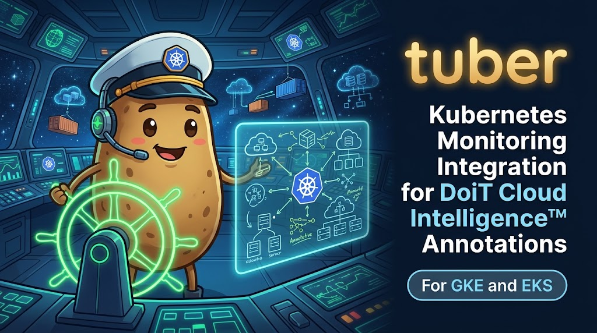

<p align="center">
  
</p>

# `tuber` — Kubernetes Workload Monitor for DoiT Cloud Analytics Annotations

`tuber` is a lightweight, in-cluster Kubernetes monitoring agent written in Go (`client-go`) for **Google Kubernetes Engine (GKE)** and **Amazon EKS** clusters. It watches workload lifecycle changes across an explicit allowlist of namespaces, applies **smart workload rollup** so replica pod churn does not flood your cost charts, and automatically creates contextual annotations in **DoiT Cloud Intelligence** via the [DoiT Annotations API](https://developer.doit.com/docs/annotations-api) (`POST https://api.doit.com/analytics/v1/annotations`).

## Start here

For the simplest installation, use the [Helm chart guide](charts/tuber/README.md).
It takes a small values file and an existing DoiT credentials Secret, and manages
the Deployment, configuration, ServiceAccount, and namespace-scoped RBAC. The
guide covers GKE/EKS, upgrades, uninstall, and migration from Kustomize. Public
OCI installation becomes available after the first chart/image release; until
then, the guide includes local chart installation with a published image override.

The following source-build and Kustomize instructions remain available for local
development and existing installations.

Run the commands below from the repository root. You need the Go version specified
in [go.mod](go.mod) to build; live runs also need a working Kubernetes context with
permission to list and watch Pods, Deployments, and Jobs in the watched namespaces.
Build or rebuild the binary after pulling source changes:

```bash
go build -o bin/tuber ./cmd/tuber
```

Choose your provider's configuration, then edit its cluster name, region, and
namespace allowlist:

| Provider | Configuration |
| :--- | :--- |
| GKE | [GKE configuration](deploy/kustomize/overlays/gke/patch-config.yaml) |
| EKS | [EKS configuration](deploy/kustomize/overlays/eks/patch-config.yaml) |

Inspect the effective settings and sample annotation text locally. This command
needs no credentials or cluster access:

```bash
./bin/tuber --config=deploy/kustomize/overlays/gke/patch-config.yaml --preview-config
```

For EKS, substitute the EKS configuration path. Confirm your Kubernetes context,
then start a dry run against the same configuration:

```bash
kubectl config current-context
./bin/tuber \
  --config=deploy/kustomize/overlays/gke/patch-config.yaml \
  --dry-run
```

Local runs use the standard kubeconfig loading rules (`KUBECONFIG`, otherwise
`$HOME/.kube/config`). To select a single file explicitly, add
`--kubeconfig=/path/to/your/existing/kubeconfig`. In-cluster runs use the pod's
Kubernetes credentials first. See [troubleshooting](#troubleshooting) if loading fails.

Wait for `all namespace informer caches synced`, then create or change a workload
in a watched namespace to see a dry-run payload. Existing workloads are suppressed
on startup. Dry runs watch the cluster but do not send annotations to DoiT.
If a token file is configured, a missing file is allowed in dry-run mode; an
existing file must still be readable.

Next, [create the credentials Secret and deploy](#deploying-to-gke-gcp-and-eks-aws).
For details, see [configuration](#customizing--expanding-the-configmap),
[command modes](#local-build-validation--dry-run-testing), and
[troubleshooting](#troubleshooting).

---

## Key Features

1. **Smart Workload Rollup (Noise Control)**:
   - **Deployments (`apps/v1`)**: Emits annotations on `Created`, `Scaled` (`spec.replicas` changes), `RolledOut` (container image or resource request/limit updates), and `Deleted`. Ignores routine replica status heartbeats.
   - **Jobs (`batch/v1`)**: Emits annotations on `Created`, `Completed` (`Complete=True`), and `Failed` (`Failed=True`).
   - **Pods (`v1`)**: Suppresses routine `Created`/`Deleted` churn for any Pod with owner references (`ignoreOwnedPods: true`), while capturing **standalone Pods** (`Created`, `Deleted`) and **`OOMKilled` container terminations** across all watched Pods.
2. **Cold-Start Suppression**:
   - Uses `client-go` `ResourceEventHandlerDetailedFuncs` (`isInInitialList`) so restarting or rolling out `tuber` itself never re-emits annotations for workloads already running in the cluster.
3. **Explicit Namespace Allowlist**:
   - Instantiates namespace-scoped `SharedInformer` factories strictly for the namespaces listed in `watchNamespaces` (wildcard `*` or empty lists are rejected at validation time).
4. **DoiT Annotations API Integration**:
   - Authenticates via `Authorization: Bearer <API_TOKEN>` and optional `X-Tenant-Id: <TENANT_ID>`.
   - Client-side token-bucket rate limiter (`golang.org/x/time/rate`, default 10 requests/second with a burst of 20) and exponential backoff on HTTP `429`/`5xx`. These limits apply per process.
5. **Per-Workload Kubernetes Annotation Overrides**:
   - `tuber.doit.com/ignore: "true"` — Skip this workload completely.
   - `tuber.doit.com/watch: "true"` — Force watching an owned Pod's `Created`/`Deleted` lifecycle even when `ignoreOwnedPods: true`.
   - `tuber.doit.com/reports: "reportId1,reportId2"` — Attach annotations for this workload to specific DoiT Cloud Analytics report IDs.
   - `tuber.doit.com/labels: "labelId1,labelId2"` — Attach pre-existing DoiT label IDs to annotations for this workload.

---

## DoiT Service Account Authentication & Permissions

Per [DoiT Getting Started — API Tokens](https://developer.doit.com/docs/start) and the [Annotations API documentation](https://developer.doit.com/docs/annotations-api), `tuber` is designed for **DoiT Service Account API tokens** (never deprecated legacy individual user API tokens):

1. **Create a DoiT Service Account API Token**:
   - Sign in to the [DoiT Console](https://console.doit.com/), click the **Gear icon** in the top navigation bar, and select **Users and access**.
   - Select **Service Accounts** from the left-hand menu.
   - Select your service account (or create one with the **Cloud Analytics Admin** role) and click **Create API token**.
2. **Startup Guardrail Against Legacy / Individual User Tokens**:
   - When `doit.validateOnStartup: true` and `doit.rejectUserTokens: true` (enabled by default in the Kustomize manifests), `tuber` validates the token against `GET https://api.doit.com/auth/v1/validate` at startup.
   - Because DoiT Service Accounts have no user email (`email: ""`), any legacy or personal token that resolves to an individual user's email address is rejected immediately with a clear error message.
3. **Service Account Report Visibility**:
   - Because service accounts have no user email, any DoiT Cloud Analytics reports referenced in `defaultReports`, rule `reports`, or `tuber.doit.com/reports` must be **shared organization-wide** or be **preset reports** (private user-only reports are unreachable by service account tokens and return `403 Forbidden`).
4. **Multi-Tenant Service Accounts (`X-Tenant-Id`)**:
   - Service account tokens ignore the deprecated `?customerContext` query parameter used by legacy keys. If your service account can access multiple tenants/customers, set `doit.tenantId` (or `DOIT_TENANT_ID`), which sends the `X-Tenant-Id` request header.

---

## Local Build, Validation & Dry-Run Testing

| Mode | Purpose | Access needed |
| :--- | :--- | :--- |
| `--preview-config` | Print selected effective settings and synthetic sample text as YAML, then exit | Configuration file only; skips token files and requires no credentials |
| `--validate-only` | Validate configuration, then exit | Configuration file; token or token-file reference required unless dry-run is enabled; existing token files must be readable |
| `--dry-run` | Watch live workload changes and log payloads | Kubernetes access; no DoiT API calls |
| Normal run | Watch changes and send annotations | Kubernetes access and DoiT credentials |

Preview and validation apply environment overrides and defaults. Preview takes
precedence if both offline flags are supplied. Neither offline mode checks live
RBAC, namespace existence, token validity, or report permissions. Preview samples
demonstrate template formatting only: selectors, routing, and workload overrides
are not simulated. Rules appear in their configured first-match order.

Preview excludes tokens, token paths, tenant ID, and API URL. It includes cluster
names, report/label IDs, selectors, and rendered annotation text; review those
values before sharing output. Structured JSON logs go to stderr; preview YAML
goes to stdout, so it can be saved directly:

```bash
./bin/tuber --config=deploy/kustomize/overlays/gke/patch-config.yaml --preview-config > preview.yaml
```

```bash
# Run all unit and end-to-end fake-cluster tests with race detector
go test -v -race ./...

# Build the tuber binary
go build -o bin/tuber ./cmd/tuber

# Validate a configuration file without connecting to a cluster
./bin/tuber --config=deploy/kustomize/base/configmap.yaml --validate-only

# Run locally using a configuration shipped in this repo and your current kubeconfig
./bin/tuber \
  --config=deploy/kustomize/overlays/gke/patch-config.yaml \
  --dry-run
```

To maintain a separate local configuration, first copy a shipped ConfigMap:

```bash
cp deploy/kustomize/overlays/gke/patch-config.yaml /tmp/tuber-config.yaml
./bin/tuber --config=/tmp/tuber-config.yaml --preview-config
```

The CLI accepts either plain tuber YAML or a single ConfigMap manifest containing
`data.config.yaml`. A patch file contains a complete configuration in that entry;
the CLI does not merge it with the base configuration. Do not pass a multi-resource
`kubectl kustomize` output as `--config`.

Run `./bin/tuber --help` for all flags. Other runtime flags are:

| Flag | Default | Purpose |
| :--- | :--- | :--- |
| `--health-addr` | `:8080` | Listen address for health/readiness probes; use `--health-addr=""` to disable them locally |
| `--leader-elect` | `false` in the CLI; `true` in the Deployment | Use a Kubernetes Lease to select one active watcher |
| `--leader-elect-namespace` | `POD_NAMESPACE`, otherwise `tuber-system` | Namespace containing the Lease |
| `--leader-elect-id` | `tuber-leader-lock` | Lease resource name |

---

## Deploying to GKE (GCP) and EKS (AWS)

### 1. Create the DoiT Service Account Credentials Secret
Either apply `deploy/kustomize/base/secret.example.yaml` with your DoiT Service Account API token or use External Secrets Operator with **GCP Secret Manager** (`deploy/kustomize/overlays/gke/externalsecret-gcp.example.yaml`) or **AWS Secrets Manager** (`deploy/kustomize/overlays/eks/externalsecret-aws.example.yaml`):

```bash
kubectl create namespace tuber-system
kubectl -n tuber-system create secret generic tuber-doit-credentials \
  --from-literal=service-account-token="YOUR_DOIT_SERVICE_ACCOUNT_TOKEN" \
  --from-literal=tenant-id=""
```

If `tuber-system` already exists, skip namespace creation. Replace the token
placeholder before running the Secret command. If using the example Secret
manifest, edit it first and apply it with `kubectl apply -f`; it is not included
automatically by the overlay.

### 2. Customize the `ConfigMap` Before Deploying

Choose the overlay file matching your cloud provider (or edit `deploy/kustomize/base/configmap.yaml` for shared defaults):
- **GKE (GCP):** `deploy/kustomize/overlays/gke/patch-config.yaml`
- **EKS (AWS):** `deploy/kustomize/overlays/eks/patch-config.yaml`

Validate your changes locally before applying:

```bash
./bin/tuber --config=deploy/kustomize/overlays/gke/patch-config.yaml --validate-only
./bin/tuber --config=deploy/kustomize/overlays/eks/patch-config.yaml --validate-only
```

### 3. Build and Select a Container Image

The Deployment currently references `ghcr.io/ericethridge/tuber:latest`. Before applying
an overlay, build and push this source to a registry your cluster can pull from,
then set an `images` entry in your chosen overlay's `kustomization.yaml`. Replace
`YOUR_REGISTRY/tuber` with your registry repository:

```bash
docker build --platform=linux/amd64 -t YOUR_REGISTRY/tuber:v1 .
docker push YOUR_REGISTRY/tuber:v1
```

Add the following alongside `resources` and `patches` in the overlay:

```yaml
images:
  - name: ghcr.io/ericethridge/tuber
    newName: YOUR_REGISTRY/tuber
    newTag: v1
```

The example targets Linux amd64 worker nodes. For arm64 workers, use
`--platform=linux/arm64` instead; the Dockerfile compiles for the selected platform.
For a new release, choose a new image tag and update the overlay to match.

Review `patch-serviceaccount.yaml` too: the checked-in GKE service account and EKS
role ARN are environment-specific. Configure them for your environment or remove
the cloud IAM annotation if you do not use it. Kubernetes workload watches use
the RBAC in `base/rbac.yaml`; DoiT uses the mounted API token.

### 4. Deploy the GKE or EKS Overlay

Choose **one** overlay for your target cluster. Inspect its rendered resources
before applying them (the render step is local):

```bash
kubectl kustomize deploy/kustomize/overlays/gke
```

```bash
# Deploy on Google Kubernetes Engine (GKE)
kubectl apply -k deploy/kustomize/overlays/gke

# Deploy on Amazon EKS
kubectl apply -k deploy/kustomize/overlays/eks
```

---

## Customizing & Expanding the `ConfigMap`

The `tuber-config` `ConfigMap` mounts `config.yaml` into the pod at `/etc/tuber/config.yaml`. Below is a complete guide to expanding namespaces, targeting DoiT reports and labels, customizing templates, and adding routing rules.

### 1. Adding Watched Namespaces (`watchNamespaces`)

`tuber` enforces an explicit `watchNamespaces` allowlist (wildcards like `*` or `all` are rejected). The base and EKS configurations watch `default`. The checked-in GKE overlay also watches `my-app-namespace` and `payments` and sets an environment-specific default report ID. Review these values before use; each namespace must exist in your target cluster.

To watch additional namespaces in your cluster, add them to `watchNamespaces` in your overlay `ConfigMap` (`deploy/kustomize/overlays/gke/patch-config.yaml` or `deploy/kustomize/overlays/eks/patch-config.yaml`, or `deploy/kustomize/base/configmap.yaml` if applying `base/`):

```yaml
    watchNamespaces:
      - default
      - my-app-namespace
      - payments
```

> **Note (Using Overlays vs. Base):** When deploying with `kubectl apply -k deploy/kustomize/overlays/gke` (or `eks`), Kustomize patches `base/configmap.yaml` with `overlays/<cloud>/patch-config.yaml`. Always edit `watchNamespaces` in the overlay's `patch-config.yaml` when deploying an overlay.
>
> **Optional Strict Namespace RBAC:** By default, `deploy/kustomize/base/rbac.yaml` binds the read-only `tuber-workload-watcher` `ClusterRole` (`get`, `list`, `watch` on `pods`, `deployments`, `jobs`) via a `ClusterRoleBinding`. Watched namespaces must still exist. Even with a `ClusterRoleBinding`, `tuber` only starts informers for the explicit `watchNamespaces` list in `config.yaml`. If you prefer strict per-namespace RBAC, replace the workload `ClusterRoleBinding` with individual `RoleBinding` objects in each watched namespace. Preserve the separate leader-election Role and RoleBinding in `tuber-system`.

---

### 2. Targeting DoiT Reports & Labels (`doit.defaultReports` & `doit.defaultLabels`)

You can attach annotations globally to specific DoiT Cloud Analytics reports and labels, per rule, or per Kubernetes workload:

* **Finding a Report ID:** Open the report in the DoiT Console (`https://console.doit.com`) and copy the alphanumeric ID from the URL (`/reports/<REPORT_ID>`). Remember that for Service Account tokens, reports must be **shared organization-wide** or be **preset reports**.
* **Finding a Label ID:** Labels must already exist in DoiT Console. You can retrieve label IDs from the DoiT Console or via `GET https://api.doit.com/analytics/v1/labels`.

```yaml
    doit:
      baseURL: https://api.doit.com
      serviceAccountTokenFile: /var/run/secrets/doit/service-account-token
      validateOnStartup: true
      rejectUserTokens: true
      defaultReports:
        - HmqMNr1uIMQQySpiBWyt
      defaultLabels:
        - utHqK0OmwbPy1au3Xy22
```

When an event occurs, `tuber` merges `defaultReports` + matched `rule.reports` + workload annotation `tuber.doit.com/reports` (deduplicated, up to 20 IDs).
Labels use the same merge order and limit. IDs must contain 1–64 ASCII letters,
digits, hyphens, or underscores; invalid IDs are omitted from the payload.

---

### 3. Customizing Annotation Text (`doit.contentTemplate`)

`doit.contentTemplate` uses Go's `text/template` syntax and is validated at startup.
Rendered annotation text is limited to 1,024 characters; event summaries are
limited to 512 characters before rendering. Control characters are removed and
line breaks are converted to spaces.

**Default template:**
```yaml
contentTemplate: "[{{.CloudProvider}}/{{.ClusterName}}] {{.Namespace}}/{{.Kind}}/{{.Name}} {{.Action}}: {{.Summary}}"
```

| Template Variable | Example Value | Description |
| :--- | :--- | :--- |
| `{{.CloudProvider}}` | `gcp-gke` / `aws-eks` | Value of `cluster.provider` |
| `{{.ClusterName}}` | `gke-prod-us-central1` | Value of `cluster.name` |
| `{{.Region}}` | `us-central1` | Value of `cluster.region` |
| `{{.Namespace}}` | `production` | Kubernetes resource namespace |
| `{{.Kind}}` | `Deployment` / `Job` / `Pod` | Kubernetes resource kind |
| `{{.APIVersion}}` | `apps/v1` / `batch/v1` / `v1` | Kubernetes resource `apiVersion` |
| `{{.Name}}` | `checkout-api` | Kubernetes resource name |
| `{{.UID}}` | `f47ac10b-58cc-...` | Kubernetes resource UID |
| `{{.Action}}` | `Created`, `Scaled`, `RolledOut`, `Deleted`, `Completed`, `Failed`, `OOMKilled` | Lifecycle transition action |
| `{{.Summary}}` | `replicas 2 -> 5 (images=api=app:v2)` | Human-readable change summary |

---

### 4. Expanding Rules for Multi-Team / Multi-Namespace Routing

You can expand the `rules:` array in `config.yaml` to filter by `namespaces`, Kubernetes `labelSelector`, and `actions`, and route matching events to team-specific DoiT reports and labels. (`tuber` evaluates `rules` in order and uses the first matching rule for a given `(apiVersion, kind, namespace, action, labels)`):

Every rule namespace must also appear in `watchNamespaces`. Empty `namespaces`
matches all watched namespaces; empty `actions` matches every action supported by
that resource's watcher. An omitted or empty `rules` list installs the three
default rules. An invalid label selector never matches an event; offline
validation currently does not reject it.

```yaml
    rules:
      # Route checkout team Deployments in production to the Checkout Cost Report
      - name: checkout-deployments
        apiVersion: apps/v1
        kind: Deployment
        namespaces:
          - production
        labelSelector: "team=checkout"
        actions:
          - Created
          - Scaled
          - RolledOut
          - Deleted
        reports:
          - 2fhAJPvPz950syFUh0Zw
        labels:
          - D8Ko0n1ze0Z185HlRfOQ

      # Fallback rule for all other Deployments in watched namespaces
      - name: default-deployments
        apiVersion: apps/v1
        kind: Deployment
        actions:
          - Created
          - Scaled
          - RolledOut
          - Deleted

      # Track batch Job completions and failures
      - name: jobs-lifecycle
        apiVersion: batch/v1
        kind: Job
        actions:
          - Created
          - Completed
          - Failed

      # Track standalone Pods and OOMKilled containers across all watched Pods
      - name: pods-standalone-and-oom
        apiVersion: v1
        kind: Pod
        actions:
          - Created
          - Deleted
          - OOMKilled
```

---

### 5. Environment Variable Overrides

The following settings support environment overrides on the `tuber` container.
Other settings, including routing rules and templates, are configured in YAML.
The binary does not automatically load `.env` files:

| Environment Variable | Overrides `config.yaml` Field | Description |
| :--- | :--- | :--- |
| `TUBER_CONFIG` | `--config` flag | Path to configuration file (default `/etc/tuber/config.yaml`) |
| `TUBER_CLUSTER_NAME` | `cluster.name` | Cluster identifier shown in annotations |
| `TUBER_CLOUD_PROVIDER` | `cluster.provider` | Cloud provider (`gcp-gke`, `aws-eks`, etc.) |
| `TUBER_CLUSTER_REGION` | `cluster.region` | Cloud region (`us-central1`, `us-east-1`, etc.) |
| `TUBER_WATCH_NAMESPACES` | `watchNamespaces` | Comma-separated namespace allowlist (e.g. `default,production,payments`) |
| `DOIT_BASE_URL` | `doit.baseURL` | DoiT API base URL (default `https://api.doit.com`) |
| `DOIT_SERVICE_ACCOUNT_TOKEN` | `doit.serviceAccountToken` | DoiT Service Account Bearer token |
| `DOIT_SERVICE_ACCOUNT_TOKEN_FILE` | `doit.serviceAccountTokenFile` | Path to mounted DoiT Service Account token file |
| `DOIT_TENANT_ID` | `doit.tenantId` | Customer tenant ID sent via `X-Tenant-Id` header |
| `DOIT_VALIDATE_ON_STARTUP` | `doit.validateOnStartup` | Set `true` or `false` to toggle `/auth/v1/validate` startup check |
| `TUBER_DRY_RUN` | `dryRun` | Set `true` to log annotation payloads without sending HTTP POSTs |

An explicit `--config` overrides `TUBER_CONFIG`; `--dry-run` forces dry-run mode
even if `TUBER_DRY_RUN=false`. The boolean environment overrides also accept
`1`/`yes` and `0`/`no` (case insensitive). Unrecognized values are ignored.
`DOIT_API_TOKEN` and `DOIT_API_TOKEN_FILE` remain legacy aliases; prefer the
`DOIT_SERVICE_ACCOUNT_*` names. A non-empty inline token takes precedence over a
token file.

---

### 6. Applying `ConfigMap` Updates to a Running Cluster

After editing your `ConfigMap` (and `rbac.yaml` if adding namespaces):

```bash
# 1. Validate the updated ConfigMap locally
./bin/tuber --config=deploy/kustomize/overlays/gke/patch-config.yaml --validate-only

# 2. Apply the updated Kustomize overlay
kubectl apply -k deploy/kustomize/overlays/gke

# 3. Restart the tuber Deployment to pick up the updated ConfigMap
kubectl -n tuber-system rollout restart deployment/tuber
kubectl -n tuber-system rollout status deployment/tuber
```

---

## Troubleshooting

Start with `--preview-config` to inspect namespaces, ordered rules, rollup settings,
and sample text. For a deployed agent, inspect its logs and rollout:

```bash
kubectl -n tuber-system logs deployment/tuber --tail=100
kubectl -n tuber-system rollout status deployment/tuber
```

| Symptom | Check and next step |
| :--- | :--- |
| Configuration validation fails | Follow the field named in the error. Check indentation, spelling, and environment overrides. Pass a plain config or a single ConfigMap/patch file containing `data.config.yaml`. |
| Kubernetes client configuration fails | Set `--kubeconfig` to a readable file for local runs. In-cluster, check the pod ServiceAccount and its mounted credentials. |
| Config file cannot be found | Run from the repository root and use a shipped `--config` path. A custom file must be created before it can be loaded. |
| Flag provided but not defined | Rebuild with `go build -o bin/tuber ./cmd/tuber`; the local binary may predate the README's flags. |
| Readiness stays unavailable | Look for informer errors. Confirm every watched namespace exists and the ServiceAccount can `list` and `watch` Pods, Deployments, and Jobs in each namespace. With leader election enabled, standby replicas have no running informers and remain unready. |
| Token file cannot be read | Check the Secret key, volume mount, and file permissions. Offline preview skips credential files; a successful preview does not verify the mount. |
| DoiT startup validation fails or returns 401/403 | Check the service account token, tenant ID, API reachability, and Cloud Analytics permissions. For report-specific 403 errors, verify report sharing as described in the authentication section. |
| Dry run produces no payloads | Wait for cache sync, then make a new workload change. Check the namespace allowlist, first matching rule, selectors, and `tuber.doit.com/ignore`. Routine owned-Pod churn and initial workloads are suppressed; repeated events may be deduplicated. |
| ConfigMap edits have no effect | Apply the overlay and restart the Deployment using the update steps above. Check environment overrides if values still differ. |

`/healthz` reports whether the health HTTP server is alive. `/readyz` reports
informer cache synchronization; it does not verify DoiT delivery. For a local run,
the endpoints listen on port 8080 by default (override with `--health-addr`).

---

## Expanding to Arbitrary Kubernetes Primitives (Phase 2 Rule Engine)

Current watchers support only `apps/v1` Deployments, `batch/v1` Jobs, and `v1`
Pods. Adding another kind to `rules` does not create a watcher for that kind.
The following describes future implementation work.

The `rules:` list in `config.yaml` is already structured around `(apiVersion, kind, namespaces, labelSelector, actions, reports, labels)`:

```yaml
rules:
  - name: deployments-lifecycle
    apiVersion: apps/v1
    kind: Deployment
    namespaces:
      - production
    labelSelector: "cost-center=checkout"
    actions:
      - Created
      - Scaled
      - RolledOut
      - Deleted
    reports:
      - HmqMNr1uIMQQySpiBWyt
    labels:
      - utHqK0OmwbPy1au3Xy22
```

To expand from typed `Deployment`/`Job`/`Pod` informers to arbitrary Kubernetes resources (e.g., `StatefulSet`, `DaemonSet`, `HorizontalPodAutoscaler`, `Ingress`, or CRDs), add a `dynamicinformer.DynamicSharedInformerFactory` in `internal/watcher/manager.go` that maps each `WatchRule`'s `apiVersion` + `kind` via RESTMapper to a `schema.GroupVersionResource` and feeds `unstructured.Unstructured` events into the same `Evaluator` $\rightarrow$ `Deduplicator` $\rightarrow$ `Formatter` $\rightarrow$ `DoiT Sink` pipeline.
